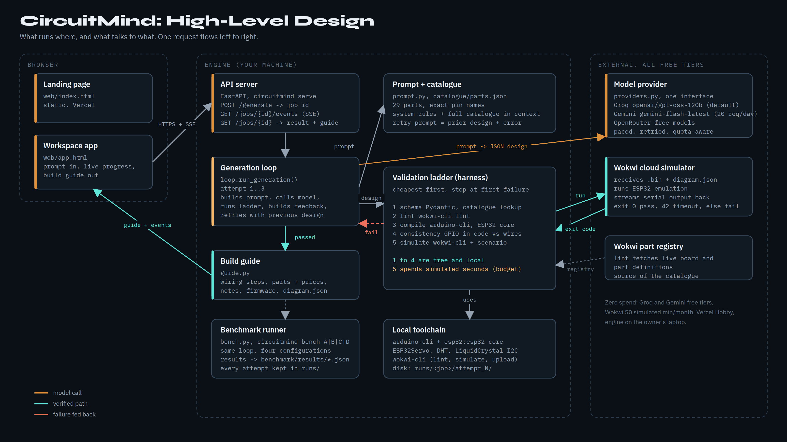
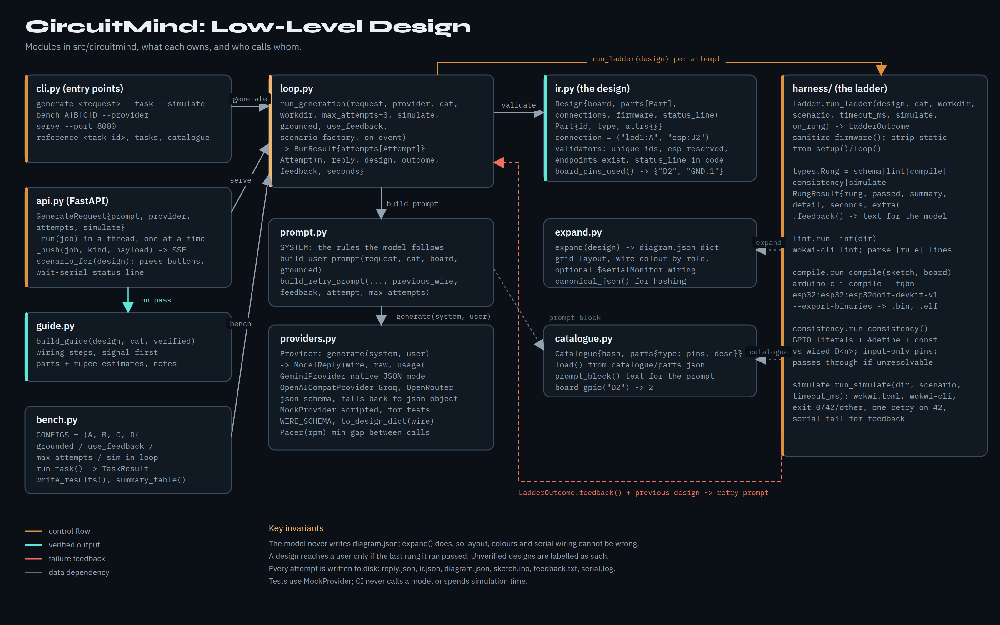
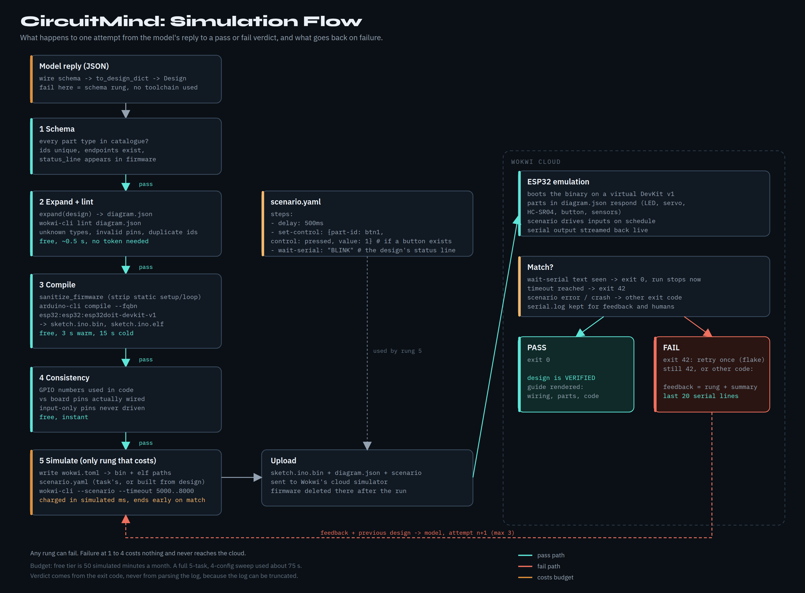

# CircuitMind

Turns a plain-English electronics project into a circuit and firmware, then proves it works by running it in the Wokwi simulator before showing it to you.

## What it does

1. You describe a project. "Blink an LED once a second and print BLINK after two cycles."
2. The system generates a small design description: which parts, how they connect, and the firmware.
3. Every free check runs first: schema, `wokwi-cli lint`, compile with `arduino-cli`, and a consistency check between firmware pin numbers and the wiring.
4. Only a design that passes all of those is simulated. Simulation minutes are capped on Wokwi's free tier, so nothing reaches the simulator that could have been rejected for free.
5. If it fails, the error goes back to the model along with its previous attempt. Three tries, then it stops and tells you why.
6. If it passes, you get the wiring guide, the annotated code, a parts list, and a link to open the exact circuit in Wokwi.

## Status

The loop works end to end, simulation included, and the first benchmark has been run.

| Version | What it has | Passed (5 tasks) |
|---|---|---|
| A | bare model | 1 |
| B | + parts catalogue in the prompt | 3 |
| C | + retry on schema, lint, compile, consistency errors | 3 |
| D | + retry on simulation errors too | 5 |

Model: `openai/gpt-oss-120b` on Groq's free tier. Full table, per-task matrix and caveats in `benchmark/results/README.md`. Five tasks is a pilot; the suite is being extended toward 25.

What that table shows: without the catalogue the model invents pin names. With it, most designs pass. Retrying on compile errors alone did not move the total, because the one wrong design in C passed every free check and only failed when it actually ran. Retrying on what the simulator saw got all five.

## Architecture

### High-level design

What runs where. The browser talks to an engine on the owner's laptop; the engine talks to a model provider and to Wokwi. Everything is on a free tier.



### Low-level design

The modules in `src/circuitmind`, what each one owns, and who calls whom. Control flow is orange, the verified output path is teal, failure feedback is red.



### Simulation flow

What happens to one attempt, from the model's JSON reply to a pass or fail verdict. Rungs 1 to 4 are free and local; only rung 5 spends simulated time, and the verdict comes from `wokwi-cli`'s exit code.



## Layout

```
benchmark/tasks/     one folder per task: task.yaml, scenario.yaml, reference/
benchmark/results/   README.md with the table, plus one JSON per configuration
catalogue/parts.json part types and their valid pins, extracted from wokwi-cli lint
docs/                demo-runs.md, real transcripts from the loop; diagrams/ (HLD, LLD, simulation flow)
src/circuitmind/     ir.py (the design schema), expand.py (schema to diagram.json),
                     catalogue.py, prompt.py, providers.py (Gemini, Groq, OpenRouter, mock),
                     loop.py (generate, check, correct), bench.py (the four configurations),
                     harness/ (the ladder), cli.py
tools/               extract_catalogue.py, setup_toolchain.sh
tests/               unit tests, no simulation, no network
web/                 landing page
```

## Running

Requires Python 3.11+, `arduino-cli` with the ESP32 core, and `wokwi-cli`. `tools/setup_toolchain.sh` installs all of it.

```
pip install -e ".[dev]"
circuitmind tasks
circuitmind reference T01_blink --no-simulate     # free rungs only, no model

export GROQ_API_KEY=gsk_...                        # free key from console.groq.com
circuitmind generate "blink an LED twice then print BLINK" --provider groq
circuitmind generate - --task T03_servo_sweep --provider groq   # use a benchmark task's prompt
# or GEMINI_API_KEY with --provider gemini (free tier is 20 requests a day on the model tested)

export WOKWI_CLI_TOKEN=wok_...                     # from https://wokwi.com/dashboard/ci
circuitmind generate - --task T01_blink --simulate # full ladder, spends simulated seconds
```

Flags on `generate`: `--attempts N` (default 3), `--no-grounded` (leave the catalogue out of the prompt), `--no-feedback` (retry without sending the error back). Those two switches are what the benchmark's four versions are built from.

Run the benchmark:

```
circuitmind bench A --provider groq      # then B, C, D
```

## Web app

The site in `web/` is static. It talks to a small API that runs on your machine:

```
circuitmind serve                        # http://127.0.0.1:8000
```

Open `web/app.html` (or the deployed site's `/app.html`), type a project, and watch the checks run. The page streams progress from the API and shows the wiring guide, parts list and firmware when a design passes. Free-form prompts get a scenario built from the design itself: any pushbutton is pressed, then the simulator waits for the status line the model declared.

Or with Docker, which bakes the toolchain and a warm build cache:

```
docker build -t circuitmind .
docker run --rm -e WOKWI_CLI_TOKEN circuitmind reference T01_blink
```

## Rebuilding the catalogue

```
python tools/extract_catalogue.py > catalogue/parts.json
```

The catalogue is whatever `wokwi-cli lint` accepts. Each part's pin list comes from lint's own error output, so it cannot drift from what the simulator validates.

## Tests

```
python -m pytest -q
```

CI runs unit tests and lint only. It never runs a simulation.

## Licence

MIT.
